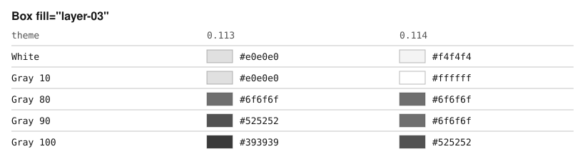
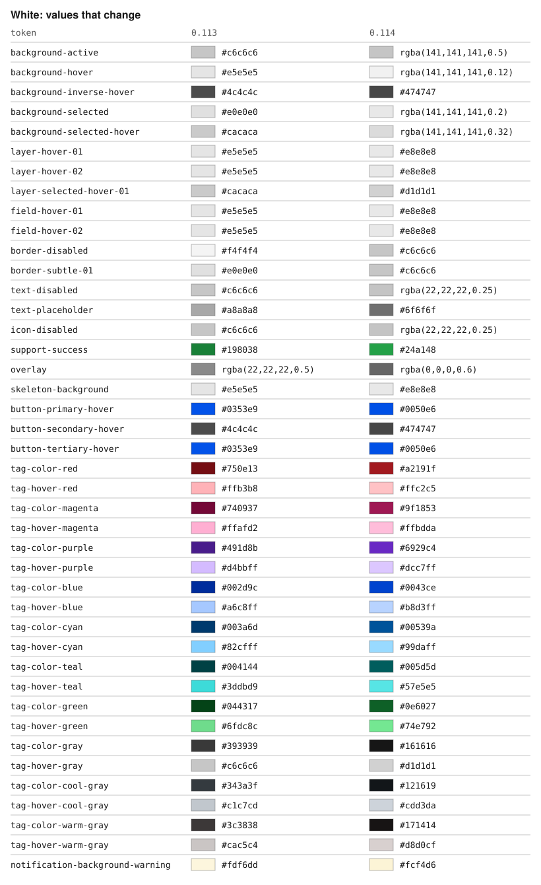
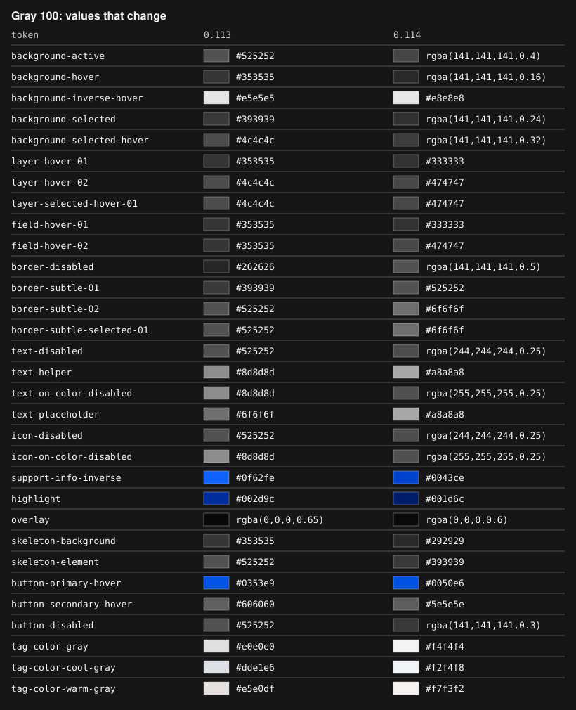
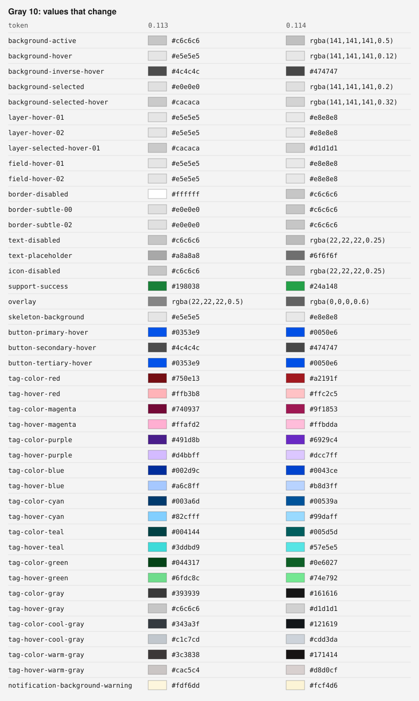
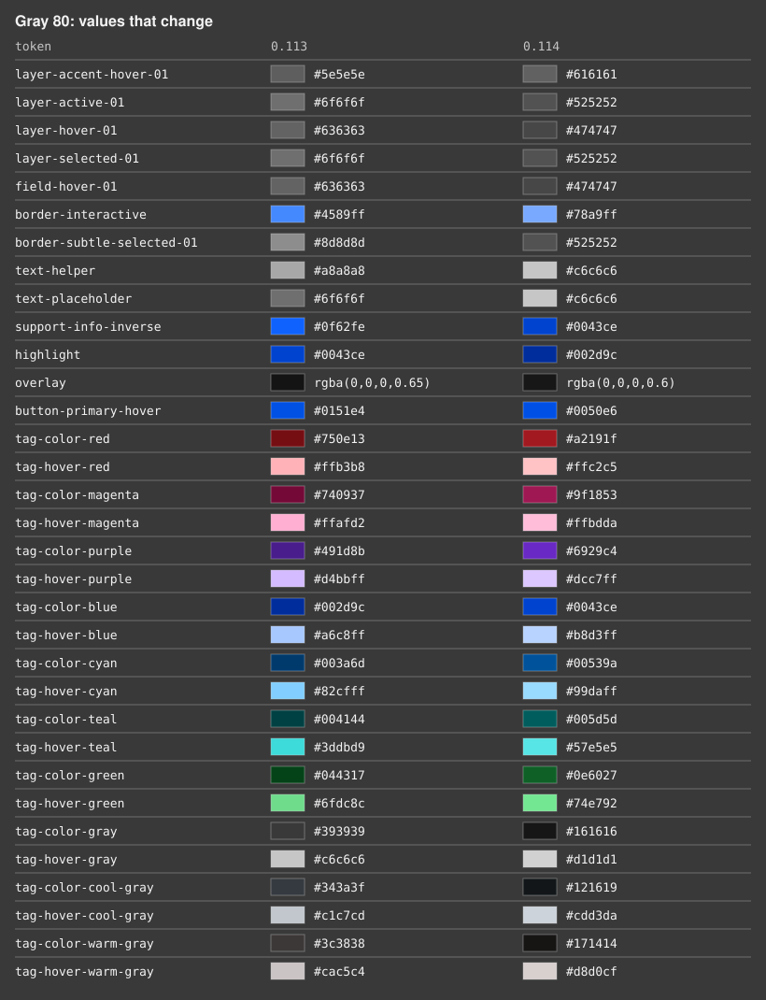
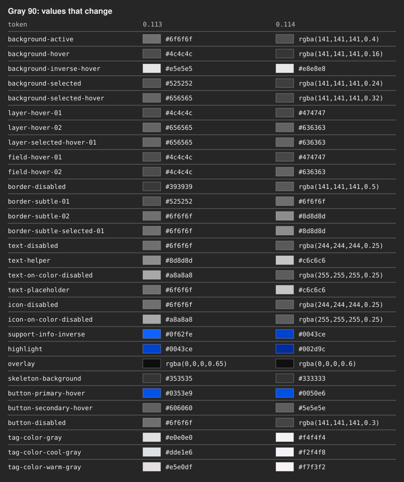
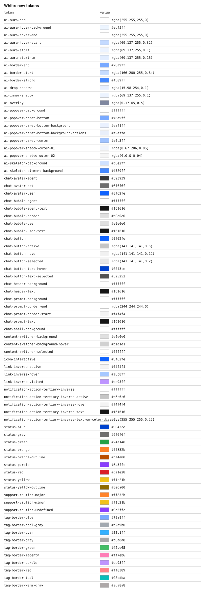
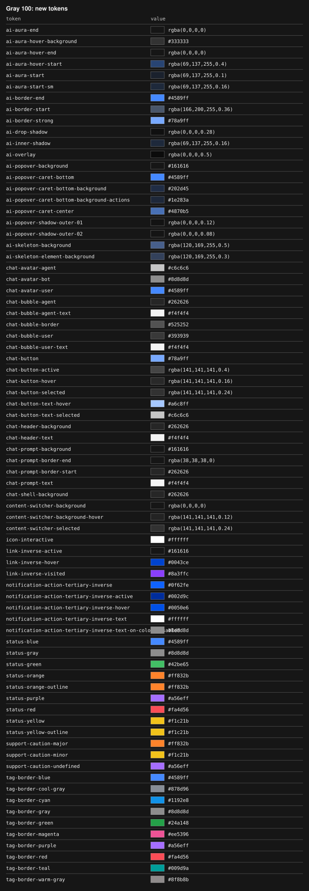

# Migrating to v0.114.x

0.114.0 brings the library in line with Carbon v11. Token names, type
style names and token values now match the v11 Figma kit. It also
replaces flatpickr with a built-in calendar and removes `light` in
favor of `Layer`.

## Breaking changes at a glance

| Change | Who it affects | PR |
| :--- | :--- | :--- |
| v10 token names (`--cds-ui-01`, `--cds-text-01`, …) are no longer declared | CSS that reads or overrides them; Theme `tokens` | [#4745](https://github.com/carbon-design-system/carbon-components-svelte/pull/4745) |
| Type styles use v11 names; `caption-01/02` are removed | `Text`, `Heading`, `.bx--type-*` | [#4745](https://github.com/carbon-design-system/carbon-components-svelte/pull/4745) |
| Token values are v11's in white, g10, g90 and g100, component tokens included; Gray 80 changes a few | Visual tests | [#4751](https://github.com/carbon-design-system/carbon-components-svelte/pull/4751), [#4898](https://github.com/carbon-design-system/carbon-components-svelte/pull/4898), [#4912](https://github.com/carbon-design-system/carbon-components-svelte/pull/4912) |
| Box and ScrollGradient `layer-03` paint the real `layer-03` | `fill="layer-03"`, `color="layer-03"` | [#4745](https://github.com/carbon-design-system/carbon-components-svelte/pull/4745) |
| Theme `tokens` is typed by token name | Custom keys in `tokens` | [#4746](https://github.com/carbon-design-system/carbon-components-svelte/pull/4746) |
| `light` is removed; use `Layer` | 25 components | [#4749](https://github.com/carbon-design-system/carbon-components-svelte/pull/4749) |
| flatpickr is replaced by a built-in calendar | DatePicker locales and plugins | [#4158](https://github.com/carbon-design-system/carbon-components-svelte/pull/4158) |
| `flatpickrProps`, plugins and hooks are removed | DatePicker options | [#4687](https://github.com/carbon-design-system/carbon-components-svelte/pull/4687) |
| `bind:calendar` is a `DatePickerCalendar` | Code that drives the calendar | [#4686](https://github.com/carbon-design-system/carbon-components-svelte/pull/4686) |
| The calendar uses `bx--date-picker__*` classes and dialog/grid roles | App CSS and tests | [#4687](https://github.com/carbon-design-system/carbon-components-svelte/pull/4687) |
| CopyInput `selectOnFocus` is `selectTextOnFocus` | CopyInput | [#4176](https://github.com/carbon-design-system/carbon-components-svelte/pull/4176) |
| DataTable zebra stripes use `layer-accent`, as in v11 | Zebra tables, visual tests | [#4914](https://github.com/carbon-design-system/carbon-components-svelte/pull/4914) |
| Modals start a Layer, so content inside sits one level up | Tiles, tables and `Layer`s in modals; CSS that styles fields in modals | [#4915](https://github.com/carbon-design-system/carbon-components-svelte/pull/4915) |
| Transactional modals stay open on an outside click | Modal without `passiveModal`; ComposedModal with a ModalFooter | [#4921](https://github.com/carbon-design-system/carbon-components-svelte/pull/4921) |
| The modal heading is an `h2` | CSS and tests that look for an `h3` | [#4970](https://github.com/carbon-design-system/carbon-components-svelte/pull/4970) |
| InlineNotification and ToastNotification default to `role="status"` | Tests that query `alert` | [#4922](https://github.com/carbon-design-system/carbon-components-svelte/pull/4922) |
| A `NotificationActionButton` in a ToastNotification is a small tertiary button, not a ghost button | Toasts with an action; CSS for the toast's action | [#4986](https://github.com/carbon-design-system/carbon-components-svelte/pull/4986) |
| An InlineNotification with an action ignores `timeout` | InlineNotification with `actions` and `timeout` | [#4991](https://github.com/carbon-design-system/carbon-components-svelte/pull/4991) |
| Search defaults to 40px | Search without `size` | [#4968](https://github.com/carbon-design-system/carbon-components-svelte/pull/4968) |
| Tags have no outer margin and a 208px width cap | Rows of tags; Tag `inline` | [#4946](https://github.com/carbon-design-system/carbon-components-svelte/pull/4946) |
| SelectableTile always shows its checkbox | Visual tests | [#4963](https://github.com/carbon-design-system/carbon-components-svelte/pull/4963) |
| The private `--ccs-status-*` and `--ccs-content-switcher-*` variables are gone | CSS that sets them | [#4877](https://github.com/carbon-design-system/carbon-components-svelte/pull/4877), [#4957](https://github.com/carbon-design-system/carbon-components-svelte/pull/4957) |

Some fixes in this release also change markup that tests can see,
such as where ARIA attributes go. See [8. Tests](#8-tests).

Most apps need three steps or fewer. Start with the checklist, then
skip any section that doesn't apply.

## Checklist

| You use… | Read |
| :--- | :--- |
| `--cds-*` custom properties in your CSS, or the Theme `tokens` prop | [1. Color tokens](#1-color-tokens) |
| `Text`, `Heading`, `.bx--type-*` classes or `--cds-<type>-*` properties | [2. Type styles](#2-type-styles) |
| The `light` prop | [3. Layer](#3-replace-light-with-layer) |
| `DatePicker` with `flatpickrProps`, `bind:calendar`, a locale import or flatpickr classes | [4. DatePicker](#4-datepicker) |
| `CopyInput selectOnFocus` | [5. CopyInput](#5-copyinput) |
| Box or ScrollGradient with `layer-03` | [6. layer-03](#6-box-and-scrollgradient-layer-03) |
| Visual tests or screenshots | [7. New colors](#7-expect-new-colors) |
| Tests that query ARIA attributes or roles | [8. Tests](#8-tests) |
| `DataTable` with `zebra` | [9. Zebra stripes](#9-datatable-zebra-stripes) |
| `Modal` or `ComposedModal` | [10. Modals](#10-modals) |
| `InlineNotification`, `ToastNotification` or `NotificationQueue` | [11. Notifications](#11-notifications) |
| `Search` without `size`, or a Carbon v11 `size` name | [12. Sizes](#12-sizes) |
| `Tag` or `SelectableTile` | [13. Tags and tiles](#13-tags-and-tiles) |
| `--ccs-status-*` or `--ccs-content-switcher-*` in your CSS | [14. Private variables](#14-private-variables) |

## Find what to change

Run this from your app's root. Each hit is a line to change.

```sh
# v10 color and type token names
rg -n -e '--cds-(ui-0|ui-background|text-0|icon-0|link-0|interactive-0|inverse-|support-0|danger|disabled-0|hover-|active-|selected-|visited-link|decorative-01|skeleton-0|overlay-01|brand-0)' \
  -e '(body-short|body-long|productive-heading|expressive-heading|expressive-paragraph|caption)-0' \
  -e '(quotation|display)-0[1-4]' src

# Props, APIs and private variables that changed
rg -n -e '\blight\b' -e 'flatpickr' -e 'selectOnFocus' -e 'bind:calendar' -e 'layer-03' \
  -e '--ccs-(status|content-switcher)' src

# Test queries that need a new role or name
rg -n -e 'Role\("alert"' -e 'name: "menu"' -e 'Title\("Clear filter"' .
```

`svelte-check` also helps. The `light` prop, `flatpickrProps`,
`selectOnFocus`, v10 `type` values and v10 Theme token keys are all
type errors now. CSS reads of v10 tokens are not, so the `rg` search
is the only way to find those.

## 1. Color tokens

all.css no longer declares v10 names. A `var(--cds-ui-01)` resolves to
nothing, and an override of `--cds-interactive-01` changes nothing. No
error appears, so search for them.

Rename `--cds-<v10>` in your CSS and `"<v10>"` keys in the Theme
`tokens` prop.

```css
/* before */
.card {
  background: var(--cds-ui-01);
  border: 1px solid var(--cds-ui-03);
  color: var(--cds-text-01);
}

/* after */
.card {
  background: var(--cds-layer-01);
  border: 1px solid var(--cds-border-subtle-01);
  color: var(--cds-text-primary);
}
```

```svelte
<!-- before -->
<Theme tokens={{ "interactive-01": "#d02670", "text-01": "#fff" }} />

<!-- after -->
<Theme tokens={{ "button-primary": "#d02670", "text-primary": "#fff" }} />
```

Carbon split some v10 tokens. Pick the v11 token by what the color
paints: borders take a `border-*` name, fills take `layer-*` or
`background-*`, text takes `text-*`, and icons take `icon-*`.

If your component sits on a surface that can change, read the
contextual token without a number (`layer`, `field`,
`border-subtle`). A `Layer` re-points those, so the component follows
its surface. See [3. Layer](#3-replace-light-with-layer).

| v10 | v11 |
| :--- | :--- |
| ui-background | background |
| ui-01 | layer-01 |
| ui-02 | layer-02 |
| ui-03 | border-subtle-01 (borders), layer-accent-01 (fills) |
| ui-04 | border-strong-01, toggle-off |
| ui-05 | border-inverse, layer-selected-inverse |
| text-01 | text-primary |
| text-02 | text-secondary |
| text-03 | text-placeholder |
| text-04 | text-on-color |
| text-05 | text-helper |
| icon-01 | icon-primary |
| icon-02 | icon-secondary |
| icon-03 | icon-on-color |
| link-01 | link-primary |
| link-02 | link-secondary |
| visited-link | link-visited |
| inverse-01 | text-inverse, icon-inverse, focus-inset |
| inverse-02 | background-inverse |
| inverse-link | link-inverse |
| inverse-focus-ui | focus-inverse |
| inverse-hover-ui | background-inverse-hover |
| inverse-support-01 to -04 | support-error-inverse, support-success-inverse, support-warning-inverse, support-info-inverse |
| support-01 to -04 | support-error, support-success, support-warning, support-info |
| interactive-01 | button-primary (buttons), background-brand |
| interactive-02 | button-secondary |
| interactive-03 | button-tertiary |
| interactive-04 | interactive, border-interactive |
| brand-01 | background-brand |
| danger, danger-01 | button-danger-primary |
| danger-02 | button-danger-secondary |
| disabled-01 | field-01, layer-01 |
| disabled-02 | text-disabled, icon-disabled, button-disabled, border-disabled |
| disabled-03 | text-on-color-disabled, icon-on-color-disabled, layer-selected-disabled |
| hover-ui, hover-row | layer-hover-01, background-hover, field-hover-01 |
| hover-light-ui | layer-hover-02 |
| hover-field | field-hover-01 |
| hover-selected-ui | layer-selected-hover-01, background-selected-hover |
| hover-primary, -secondary, -tertiary, -danger | button-primary-hover, button-secondary-hover, button-tertiary-hover, button-danger-hover |
| hover-primary-text | link-primary-hover |
| active-ui | layer-active-01, background-active, border-subtle-selected-01 |
| active-light-ui | layer-active-02 |
| active-primary, -secondary, -tertiary, -danger | button-primary-active, button-secondary-active, button-tertiary-active, button-danger-active |
| selected-ui | layer-selected-01, background-selected |
| selected-light-ui | layer-selected-02 |
| decorative-01 | border-subtle-02 |
| skeleton-01 | skeleton-background |
| skeleton-02 | skeleton-element |
| overlay-01 | overlay |

Carbon's own table:
https://github.com/carbon-design-system/carbon/blob/main/docs/migration/v11.md#design-tokens

A few notes:

- `text-placeholder` keeps `text-helper`'s value. v11's placeholder
  gray is 2.6:1 on a white field, below WCAG AA. If you overrode
  `text-03`, set `text-placeholder` to the same value.
- The Theme `tokens` prop now only accepts names all.css declares, and
  your editor completes them. Each key is set as `--cds-{key}`. To set
  a name outside the list, cast the object:

  ```svelte
  <script lang="ts">
    import { Theme } from "carbon-components-svelte";
    import type { ComponentProps } from "svelte";

    const tokens = {
      "button-primary": "#d02670",
      "brand-accent": "#d02670",
    } as ComponentProps<Theme>["tokens"];
  </script>

  <Theme {tokens} />
  ```

- The new `carbon-components-svelte/tokens` export lists every token
  with its value per theme, if you need them in JavaScript.
- The single-theme files (white.css, g10.css, …) compile most values
  in. Only the contextual tokens (`layer`, `field`, `border-subtle`
  and similar) are custom properties there, so that `Layer` works.

## 2. Type styles

The same names apply to the `Text` and `Heading` `type` prop, the
`.bx--type-*` classes and the custom properties
(`--cds-body-short-01-font-size` is now
`--cds-body-compact-01-font-size`).

```svelte
<!-- before -->
<Text type="body-short-01">Saved</Text>
<Heading type="productive-heading-03">Settings</Heading>
<p class="bx--type-caption-01">Updated today</p>

<!-- after -->
<Text type="body-compact-01">Saved</Text>
<Heading type="heading-03">Settings</Heading>
<p class="bx--type-label-01">Updated today</p>
```

| v10 | v11 |
| :--- | :--- |
| caption-01, caption-02 | label-01, label-02 |
| body-short-01, -02 | body-compact-01, -02 |
| body-long-01, -02 | body-01, body-02 |
| productive-heading-01, -02 | heading-compact-01, -02 |
| productive-heading-03 to -07 | heading-03 to heading-07 |
| expressive-heading-01, -02 | heading-01, heading-02 |
| expressive-heading-03 to -06 | fluid-heading-03 to -06 |
| expressive-paragraph-01 | fluid-paragraph-01 |
| quotation-01, -02 | fluid-quotation-01, -02 |
| display-01 to -04 | fluid-display-01 to -04 |

`label-*`, `helper-text-*`, `code-*`, `heading-01` and `heading-02`
keep their names. `legal-01` and `legal-02` are new.

Two styles look a little different:

- `caption-02` had 0.32px letter spacing. `label-02` has 0.16px.
- `expressive-heading-01` had a 1.25 line height. `heading-01` has
  1.42857.

`Text` still defaults to the same style. Its default is now called
`body-01`.

## 3. Replace `light` with Layer

v11 removed `light`. A `Layer` re-points the contextual tokens, so
every component inside it takes the next surface. Fields, tiles and
menus all follow.

```svelte
<!-- before -->
<TextInput light labelText="Workspace name" />

<!-- after -->
<script>
  import { Layer, TextInput } from "carbon-components-svelte";
</script>

<Layer>
  <TextInput labelText="Workspace name" />
</Layer>
```

| Example | `light` in 0.113 | `<Layer>` in 0.114 |
| :--- | :--- | :--- |
| TextInput, White |  |  |
| TextInput, Gray 100 |  |  |
| Tile, White |  |  |
| Tile, Gray 100 |  |  |

In White, a `light` field was white on the white page. In a Layer it
sits on its own surface.

Nested layers step up one level each, to a maximum of three. Use
`withBackground` when the layer should paint its own surface:

```svelte
<Layer withBackground>
  <TextInput labelText="On layer 2" />
  <Layer withBackground>
    <TextInput labelText="On layer 3" />
  </Layer>
</Layer>
```

| Nested layers | White | Gray 100 |
| :--- | :--- | :--- |
| Fields |  |  |
| Tiles |  |  |

`light` was removed from TextInput, PasswordInput, TextArea,
NumberInput, Select, Search, SearchMenu, ComboBox, Dropdown,
MultiSelect, ListBox, DatePicker, TimePicker, Slider, RangeSlider,
CopyInput, PinCodeInput, CodeSnippet, OverflowMenu, Popover, Tile,
ClickableTile, ExpandableTile, RadioTile and SelectableTile. The
`--light` classes are gone too, so remove any CSS that targets them.

Fields inside a Modal already take the next layer. Just drop `light`
there.

## 4. DatePicker

flatpickr is gone. The calendar is built in, each option is a prop,
and the markup uses Carbon class names. If you only pass `value`,
`datePickerType`, `dateFormat`, `minDate` or `maxDate`, your app needs
no change. Tests that query the calendar still do; see
[CSS and tests](#css-and-tests).

The calendar looks the same. Each pair below shows flatpickr in 0.113
on the left and the built-in calendar on the right:


### Options

Move each `flatpickrProps` key to its prop:

| flatpickrProps | Prop |
| :--- | :--- |
| `minDate`, `maxDate`, `allowInput`, `closeOnSelect`, `conjunction`, `inline` | same name |
| `showMonths` | `months` |
| `shorthandCurrentMonth` | `monthLabel="short"` |
| `positionElement` | `anchor` |
| `position` | `align` and `direction` (with `portalMenu`; the default calendar always opens below the field) |
| `allowInvalidPreload` | `keepOutOfRangeValue` |
| `ignoredFocusElements` | `keepOpenFor` |
| `disable` | `disabledDates` |
| `enable` | `enabledDates` |
| `altInput`, `altFormat` | `displayFormat` |
| `defaultDate` | `value` or `selectedDates` |

```svelte
<!-- before -->
<DatePicker
  datePickerType="single"
  flatpickrProps={{ showMonths: 2, disable: [isWeekend] }}
/>

<!-- after -->
<DatePicker datePickerType="single" months={2} disabledDates={[isWeekend]} />
```

### Hooks and plugins

- Replace `onDayCreate` with `dayClass` or `dayDescription`.
- Replace the other hooks with events: `on:change`, `on:open`,
  `on:close`, `on:view`, `on:error`.
- Replace the range, monthSelect and weekSelect plugins with
  `datePickerType="range"`, `"month"` or `"week"`. `"quarter"` is new.
  Other plugins are not supported.

### Locales

A language tag needs no import:

```svelte
<!-- before -->
<script>
  import { German } from "flatpickr/dist/l10n/de";
</script>
<DatePicker locale={German} />

<!-- after -->
<DatePicker locale="de" />
```

Month and weekday names then come from the browser's `Intl` data, so
they can differ slightly between browsers. A locale object still
works when you need exact strings. If you keep importing from
`flatpickr/dist/l10n`, add `flatpickr` to your own dependencies; the
package no longer installs it.

### `bind:calendar`

`bind:calendar` is a `DatePickerCalendar`, not the flatpickr instance:

```svelte
<script>
  let calendar;
</script>

<DatePicker bind:calendar>…</DatePicker>
<Button on:click={() => calendar.showMonth(new Date(2027, 0, 1))}>January</Button>
```

| flatpickr instance | DatePickerCalendar |
| :--- | :--- |
| `open()`, `close()` | `open()`, `close()`, or `bind:open` |
| `isOpen` | `isOpen` |
| `jumpToDate(date)` | `showMonth(date)` |
| `currentYear`, `currentMonth` | `view` (a Date) |
| `selectedDates` | `selectedDates` (read-only) |
| `setDate(...)` | `bind:selectedDates` or `bind:value` |

### Not available

The calendar has no time picker; pair it with `TimePicker`. The native
mobile date input and the month dropdown are not available either.

### CSS and tests

Rename flatpickr classes in app CSS and test selectors:

| flatpickr | Carbon |
| :--- | :--- |
| `flatpickr-calendar` (`open`, `inline`, `static`) | `bx--date-picker__calendar` (`--open`, `--inline`, `--static`) |
| `flatpickr-prev-month`, `flatpickr-next-month` | `bx--date-picker__nav-button--previous`, `--next` |
| `cur-month`, `cur-year` | `bx--date-picker__month-label`, `bx--date-picker__year-input` |
| `dayContainer` | `bx--date-picker__month-days`, with a `bx--date-picker__week` per row |
| `flatpickr-day` (`selected`, `today`, `inRange`, `startRange`, `endRange`, `flatpickr-disabled`) | `bx--date-picker__day` (`--selected`, `--today`, `--in-range`, `--range-start`, `--range-end`, `--disabled`) |
| `prevMonthDay`, `nextMonthDay` | `bx--date-picker__day--outside-month` |
| `flatpickr-monthSelect-month`, `flatpickr-yearSelect-year` | `bx--date-picker__grid-cell` |

Better still, query by role. The calendar is now a dialog of month
grids:

```js
const calendar = screen.getByRole("dialog", { name: "Choose a date" });
const day = within(calendar).getByRole("gridcell", { name: /15/ });
```

An inline calendar is a `group`, not a dialog. Set the name with
`calendarLabelText`.

## 5. CopyInput

`selectOnFocus` is now `selectTextOnFocus`, like every other input.
Behavior is the same.

```svelte
<!-- before -->
<CopyInput selectOnFocus value={apiKey} />

<!-- after -->
<CopyInput selectTextOnFocus value={apiKey} />
```

## 6. Box and ScrollGradient `layer-03`

`fill="layer-03"` and `color="layer-03"` now paint the real `layer-03`
token. Before, they matched `layer-accent`. To keep the old color, use
`layer-accent`:

```svelte
<!-- keeps the 0.113 color -->
<Box fill="layer-accent">…</Box>
```



## 7. Expect new colors

In white, g10, g90 and g100, 30 to 45 token values change to v11's,
including button, tag and notification colors. You don't need to
change code for this, but visual snapshots will change. The largest
changes:

| Token | White before | White after | Gray 100 before | Gray 100 after |
| :--- | :--- | :--- | :--- | :--- |
| border-subtle-01 | #e0e0e0 | #c6c6c6 | #393939 | #525252 |
| layer-hover-01 | #e5e5e5 | #e8e8e8 | #353535 | #333333 |
| background-hover | #e5e5e5 | rgba(141, 141, 141, 0.12) | #353535 | rgba(141, 141, 141, 0.16) |
| background-active | #c6c6c6 | rgba(141, 141, 141, 0.5) | #525252 | rgba(141, 141, 141, 0.4) |
| text-disabled | #c6c6c6 | rgba(22, 22, 22, 0.25) | #525252 | rgba(244, 244, 244, 0.25) |
| field-hover-01 | #e5e5e5 | #e8e8e8 | #353535 | #333333 |
| overlay | rgba(22, 22, 22, 0.5) | rgba(0, 0, 0, 0.6) | rgba(0, 0, 0, 0.65) | rgba(0, 0, 0, 0.6) |
| skeleton-background | #e5e5e5 | #e8e8e8 | #353535 | #292929 |
| support-success | #198038 | #24a148 | #42be65 | #42be65 |
| button-primary-hover | #0353e9 | #0050e6 | #0353e9 | #0050e6 |
| tag-color-red | #750e13 | #a2191f | #ffd7d9 | #ffd7d9 |

Here is how that looks on components:

| Change | 0.113 | 0.114 |
| :--- | :--- | :--- |
| DataTable row hover, White |  |  |
| DataTable row hover, Gray 100 |  |  |
| Disabled TextInput, White |  |  |
| Disabled TextInput, Gray 100 |  |  |
| Accordion, White |  |  |
| Accordion, Gray 100 |  |  |

Every value that changes, drawn on its theme's background:





<details>
<summary>Gray 10, Gray 80 and Gray 90</summary>







</details>

Hovers and disabled colors are now translucent, so they take on the
surface below them. Borders at the page level keep their color; only
borders inside a Layer change.

`text-placeholder` now holds the helper text gray. Placeholders
already drew in that gray in 0.113, so they change only where
`text-helper` changes.

The low contrast ContentSwitcher reads v11's `content-switcher-*`
tokens, so its container, hover and selected colors match v11.

Pagination now draws the 1px lines beside its page size and page
selects, as v11 does. They never rendered before
([#4998](https://github.com/carbon-design-system/carbon-components-svelte/pull/4998)).

g80 has no v11 theme, so it keeps its palette, with these exceptions:

- The primary button hover takes v11's `#0050e6`, and tag colors
  follow White's.
- Layer hovers change from #636363 to #474747, and the active and
  selected layer colors from #6f6f6f to #525252.
- `text-helper` goes from #a8a8a8 to #c6c6c6, and `border-interactive`
  from #4589ff to #78a9ff. Both failed contrast on g80's lighter
  layers. `text-placeholder` takes the same #c6c6c6.
- `highlight`, `overlay` and `support-info-inverse` take g90's v11
  values, as they matched g90 before.

New tokens you can use: `ai-*` for AI labels, `chat-*` for chat UIs,
`icon-interactive`, `link-inverse-*`, `support-caution-*`,
`layer-background-*`, `border-tile-*`, `status-*` for status
indicators, `tag-border-*`, `content-switcher-*` and
`notification-action-tertiary-inverse-*`.

<details>
<summary>New token values in White and Gray 100</summary>





</details>

## 8. Tests

These are fixes, not API changes, but tests can notice them.

- **ARIA attributes moved.** In about 30 components, a consumer
  `aria-label`, `aria-labelledby` or `aria-describedby` now goes on
  the focusable or role element, not a wrapper. A consumer
  `aria-describedby` now joins the built-in helper and error ids
  instead of replacing them. Update snapshots and attribute queries.
- **Read-only number fields are text inputs.** A read-only NumberInput
  or `type="number"` TextInput has the role `textbox`. Change
  `getByRole("spinbutton")` to `getByRole("textbox")`.
- **Read-only Slider and RangeSlider show text.** The inputs are
  hidden, so they fire no `focus` or `blur`, and a label click focuses
  nothing.
- **ComboBox needs focus for input.** An `input` event on an unfocused
  ComboBox no longer opens the menu. Focus the input first, or use
  `user.type`, which focuses it for you.
- **ClickableTile and HeaderPanelLink without `href`** are buttons now
  (`role="button"` on the tile, a `button` element for the link).
- **DatePicker** has new roles and classes; see
  [CSS and tests](#css-and-tests).
- **Right-to-left pages mirror.** Under `dir="rtl"`, the UI Shell,
  menus, list boxes, TreeView, Tabs, Pagination, the text fields and
  Slider flip their layout, and forward and back icons mirror. Left
  and Right swap in Slider, RangeSlider, TreeView, Tabs and Carousel,
  as they do in a native range input. CodeSnippet code stays left to
  right. Left-to-right pages are unchanged.
- **CopyInput sets `dir="auto"`** on its input, so a URL keeps its
  order in a right-to-left page. Pass `dir` to override it.
- **ClickableTile is `position: relative`**, as in v11. Content you
  position absolutely inside a tile now anchors to the tile.
- **Notifications are `status`, not `alert`.** See
  [11. Notifications](#11-notifications).
- **A notification title always has an id.** A
  NotificationActionButton's `aria-describedby` points at it, so
  screen readers read the title with the action.
- **NotificationQueue is a landmark.** Query it with
  `getByRole("region", { name: "Notifications" })`.
- **The modal heading is an `h2`.** Heading queries for the modal
  title need `level: 2`, not `level: 3`.
- **OverflowMenu's trigger is named "Options".** Its default name was
  "menu". `iconDescription` now sets the name and the tooltip.
- **A filterable Tag's close button has no `title`.** It shows a
  tooltip instead. Query it by role and name, not by title.

## 9. DataTable zebra stripes

Zebra stripes now use `layer-accent`, as in v11, so they stay visible
inside a `Layer`. Before, a table in a `Layer` lost its stripes. You
don't need to change code, but the stripe color changes:

| Theme | 0.113 | 0.114 |
| :--- | :--- | :--- |
| White | #ffffff | #e0e0e0 |
| Gray 10 | #f4f4f4 | #e0e0e0 |
| Gray 80 | #525252 | #6f6f6f |
| Gray 90 | #525252 | #525252 (changes only inside a Layer) |
| Gray 100 | #393939 | #393939 (changes only inside a Layer) |

The table header already uses `layer-accent`, so the header and the
stripes now match, as in v11.

| Zebra table | 0.113 | 0.114 |
| :--- | :--- | :--- |
| White |  |  |
| White, in a Layer |  |  |
| Gray 100, in a Layer |  |  |

## 10. Modals

Three things change in `Modal` and `ComposedModal`.

### Modals start a Layer

The modal now works as in v11: it sits on the first surface, and its
body is a `Layer`. Everything in the body moves up one level by
itself:

- Tiles, DataTable rows and Accordions no longer blend into the modal
  background.
- A `<Layer>` inside a modal now steps up again. Before, it did
  nothing.
- Field backgrounds look the same as before. In Gray 80, 90 and 100,
  field bottom borders and the NumberInput divider change slightly,
  to match v11.
- The modal InterstitialScreen gets the same change.

If you styled fields inside modals with your own CSS, check it. The
library no longer pins modal fields with high-specificity rules, so a
one-class rule of yours now wins where it lost before.

Menus that open from a modal (Dropdown, ComboBox, MultiSelect,
OverflowMenu, the DatePicker calendar) render outside it and stay on the
first surface, as before.

| Modal | 0.113 | 0.114 |
| :--- | :--- | :--- |
| White |  |  |
| Gray 100 |  |  |

### Transactional modals stay open on an outside click

As in v11, a click outside a modal closes it only when the modal is
passive. A Modal with `passiveModal`, or a ComposedModal without a
`ModalFooter`, still closes. Any other modal stays open, so the user
must pick an action.

`preventCloseOnClickOutside` now defaults to `undefined`, which
follows that rule. To close on an outside click as before, set it to
`false`:

```svelte
<Modal preventCloseOnClickOutside={false} … />
```

### The heading is an `h2`

The Modal heading and the ModalHeader `title` render as `h2`, not
`h3`, as in v11. Update CSS that targets `h3` and tests that query a
level 3 heading.

## 11. Notifications

### Notifications default to `role="status"`

`InlineNotification` and `ToastNotification` now default to
`role="status"`, as in v11. Screen readers announce them politely.
Before, every notification was an `alert`, even a success.

Update tests that query the role:

```js
// before
screen.getByRole("alert");

// after
screen.getByRole("status");
```

For an urgent message, such as an error the user must act on, pass
`role="alert"`. The status icon now has a name, such as "Warning".
Set it with `statusIconDescription`.

### Toast actions are tertiary buttons

A `NotificationActionButton` inside a `ToastNotification` now renders
as a small tertiary button, as in v11. Before, it was the ghost
button from InlineNotification, and its label was hard to read on a
dark toast. This applies anywhere in the toast, the default slot
included. Its class is now `bx--toast-notification__action-button`.

Toasts also have an `actions` slot, as InlineNotification does. It
puts the action under the text:

```svelte
<!-- before -->
<ToastNotification actionable title="Upload failed">
  <NotificationActionButton>Retry</NotificationActionButton>
</ToastNotification>

<!-- after -->
<ToastNotification actionable title="Upload failed">
  <svelte:fragment slot="actions">
    <NotificationActionButton>Retry</NotificationActionButton>
  </svelte:fragment>
</ToastNotification>
```

### A notification with an action ignores `timeout`

An InlineNotification with an action in its `actions` slot no longer
closes after `timeout`. As in v11, a notification with an action stays
until the user acts on it or closes it, so a timer can't remove the
action before a keyboard or screen reader user reaches it. An
`actionable` notification and a toast with an action work the same
way.

If you need it gone after a delay, set `open` to `false` yourself, or
move the action out of the notification.

### NotificationQueue

The queue is now a landmark named "Notifications". Set `labelText` to
rename it. Every toast's timer pauses while the pointer or focus is in
the queue, and resumes with the time it had left. Press F6 to move
focus to the newest toast and back.

## 12. Sizes

### Search defaults to 40px

A `Search` without `size` is now 40px tall (`lg`), like the other
fields and v11. Before, it was 48px. `ToolbarSearch` stays 48px. To
keep the old height, set `size="xl"`:

```svelte
<Search size="xl" />
```

### Carbon v11 size names

You don't need to change code. Components now accept Carbon v11's
size names next to their own, so code ported from Carbon React gets
the right height. Your existing names keep their meaning
([#4974](https://github.com/carbon-design-system/carbon-components-svelte/pull/4974)).

| Component | v11 names you can use |
| :--- | :--- |
| Button, FileUploader | `sm` (`small`), `md` (`field`), `2xl` (`xl`) |
| Text fields, Select, NumberInput, DatePicker, TimePicker, Form, InputGroup | `md` (40px default), `lg` (`xl`) |
| PinCodeInput | `md` (`default`), `lg` (`xl`) |
| ComboBox, Dropdown, MultiSelect | `md` (40px default) |
| Search, SearchMenu | `md` (`lg`, 40px) |
| Accordion, ContentSwitcher, OverflowMenu | `md` (default), `lg` (`xl`) |
| Tag, Toggle | `md` (`default`) |
| FileUploaderItem, FileDownloadItem | `sm` (`small`), `md` (`field`), `lg` (`default`) |
| Modal, ComposedModal | `md` (default width) |
| TreeView | `xs` (`compact`), `sm` (`default`) |
| DataTable | `xs`, `sm`, `md`, `lg`, `xl` (compact to tall) |
| DataTable Toolbar | `lg` (`default`) |

Two v11 names already mean something else here, and keep that
meaning:

- Button's `lg` is 64px and `xl` is 80px. For v11's 48px `lg`, use
  `default`. For v11's 64px `xl`, use `lg`.
- Search's `lg` is 40px. For v11's 48px `lg`, use `xl`.

An explicit `md` on a field now wins over a parent `Form` size.

## 13. Tags and tiles

Tags no longer have an outer margin, as in v11. Space them with their
container: `TagSet` spaces its tags for you, or use a horizontal
`Stack`. `gap={3}` gives the 8px v11 uses. The `inline` prop has no
effect and is deprecated.

```svelte
<!-- before: each tag brought its own margin -->
<Tag>IBM Cloud</Tag>
<Tag type="blue">Machine learning</Tag>

<!-- after -->
<Stack orientation="horizontal" gap={3}>
  <Tag>IBM Cloud</Tag>
  <Tag type="blue">Machine learning</Tag>
</Stack>
```

Tags are also capped at 208px wide, as in v11. A longer label
truncates and shows in full in a tooltip. Set `maxWidth` to change
the cap.

`SelectableTile` shows the v11 checkbox: an empty box until the tile
is selected, then a checked box. Before, a round checkmark showed only
when selected. Expect new visual snapshots.

## 14. Private variables

Skip this section unless you set these variables by hand. They were
never documented. all.css no longer declares them:

| Removed | Use instead |
| :--- | :--- |
| `--ccs-status-*` | `--cds-status-*` (red, orange, yellow, green, blue, purple, gray) |
| `--ccs-content-switcher-low-contrast-background` | `--cds-content-switcher-background` |

The low contrast ContentSwitcher also reads
`--cds-content-switcher-selected` and
`--cds-content-switcher-background-hover`.

## New in 0.114

You don't need these to upgrade, but they may replace code you wrote
yourself.

- [Card](https://svelte.carbondesignsystem.com/components/Card):
  v11's preview Card. Its API may change in a minor release.
- [CssGrid and CssColumn](https://svelte.carbondesignsystem.com/components/CssGrid):
  v11's CSS grid. Set v11's
  [`--cds-grid-*` properties](https://svelte.carbondesignsystem.com/components/CssGrid#custom-properties)
  on `:root`, any ancestor or the grid itself.
- [Prose](https://svelte.carbondesignsystem.com/components/Prose):
  styles plain HTML, such as rendered Markdown. Import the opt-in
  `prose.css`, or `prose-<theme>.css` with a single-theme sheet.
- [ThemeZone](https://svelte.carbondesignsystem.com/components/ThemeZone):
  renders part of a page in another theme.
- [`theme="system"`](https://svelte.carbondesignsystem.com/components/Theme#follow-the-system-with-css-only):
  follows the OS color scheme with CSS only.
- [`createTheme`](https://svelte.carbondesignsystem.com/components/Theme#brand-theme)
  and the [theme builder](https://svelte.carbondesignsystem.com/theme-builder):
  a brand theme from one color.
- [LayoutDirection](https://svelte.carbondesignsystem.com/components/LayoutDirection):
  sets the writing direction, such as right to left, for part of a
  page. Components mirror their layout in RTL.
- [Callout](https://svelte.carbondesignsystem.com/components/Callout):
  static guidance next to content.
- [Actionable notifications](https://svelte.carbondesignsystem.com/components/ToastNotification#actionable):
  `actionable` on InlineNotification and ToastNotification.
- [ToastNotification `actions`](https://svelte.carbondesignsystem.com/components/ToastNotification#actions):
  an action under the toast's text, as on InlineNotification.
- [NotificationQueue `action`](https://svelte.carbondesignsystem.com/components/NotificationQueue#actions):
  an action on a queued toast, such as an undo.
- [ChatButton](https://svelte.carbondesignsystem.com/components/ChatButton):
  pill-shaped buttons for chat.
- [InlineEdit](https://svelte.carbondesignsystem.com/components/InlineEdit):
  edit text in place.
- [Truncate `reveal`](https://svelte.carbondesignsystem.com/components/Truncate#tooltip):
  shows clipped text in a tooltip or with an expand button.
- [Dropdown](https://svelte.carbondesignsystem.com/components/Dropdown#empty-state),
  [ComboBox](https://svelte.carbondesignsystem.com/components/ComboBox#empty-state)
  and [MultiSelect](https://svelte.carbondesignsystem.com/components/MultiSelect#empty-state):
  empty and loading states. Dropdown and ComboBox group items under
  headers.
- [UserAvatar `status`](https://svelte.carbondesignsystem.com/components/UserAvatar#status):
  a presence badge.
- [Pagination `pageInputType="input"`](https://svelte.carbondesignsystem.com/components/Pagination#page-number-input):
  a number input to jump to any page.

## Check your work

1. Run `svelte-check`. It flags `light`, `flatpickrProps`,
   `selectOnFocus`, v10 `type` values and v10 Theme token keys.
2. Run the `rg` search again. It should find nothing.
3. Run your tests. Look for `alert` roles, `h3` modal headings and
   the old OverflowMenu name.
4. Open your app in each theme you ship. Look at fields, tiles,
   tags, zebra tables, modals, hovers and disabled controls.
